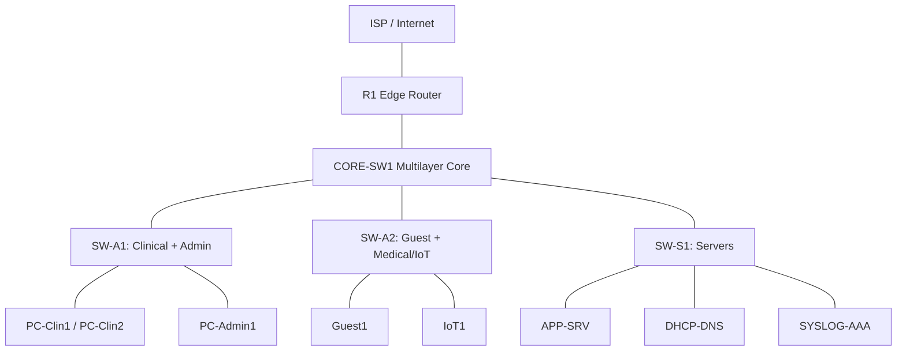

# HealthNet - Segmented Clinical Network Lab


A scaled-down model of a hospital network, built in Cisco Packet Tracer. It separates clinical, admin, guest, medical-device, and server traffic into isolated zones and enforces least-privilege access between them.

This is a lab project. It is modeled on the kind of clinical environment I support in my IT role, but it is not a production system and does not claim to match one in scale.

## Why this project exists

Hospital networks carry patient records, clinical workstations, and medical devices on the same infrastructure. If a guest laptop can reach a medical device or an EHR server, that is a security and HIPAA problem. The standard fix is segmentation: split the network into zones and allow only the traffic each zone actually needs.

This project demonstrates that design end to end: build it, restrict it, test it, break it, and fix it.

## Topology



*(Add a screenshot of the Packet Tracer topology to `/screenshots` and link it here.)*

## Addressing plan

| VLAN | Name | Subnet | Gateway |
|---|---|---|---|
| 10 | CLINICAL | 10.10.10.0/24 | 10.10.10.1 |
| 20 | ADMIN | 10.10.20.0/24 | 10.10.20.1 |
| 30 | GUEST | 10.10.30.0/24 | 10.10.30.1 |
| 40 | MEDICAL-IOT | 10.10.40.0/24 | 10.10.40.1 |
| 50 | SERVERS | 10.10.50.0/24 | 10.10.50.1 |
| 99 | MGMT | 10.10.99.0/24 | 10.10.99.1 |
| 999 | BLACKHOLE (native VLAN, unused) | none | none |

## Access policy (least privilege)

| Source | Allowed | Denied |
|---|---|---|
| Clinical | App server (443), DNS | Guest, Medical-IoT initiation, Management |
| Admin | Servers, Management | Medical-IoT |
| Guest | Internet only | All internal VLANs |
| Medical-IoT | App server (443) | Anything initiated into this VLAN |
| Management | Admin only | All others |

## Features

- 6 VLANs plus a blackhole native VLAN
- 3 trunk links carrying only the VLANs each switch needs
- Inter-VLAN routing on a multilayer core switch
- Centralized DHCP with relay (`ip helper-address`)
- Least-privilege ACLs
- SSH-only management, role-based access (helpdesk vs. admin), port security
- Syslog and NTP to the server segment
- NAT/PAT at the edge router

## Project status

- [x] Topology, addressing plan, access policy
- [x] Base device configs (VLANs, trunks, inter-VLAN routing, DHCP relay)
- [x] Security configs written: ACLs, SSH-only, role-based local accounts, port security, syslog, NTP, NAT
- [x] ACL policy verified by script: 20/20 cases (`tools/verify_policy.py`)
- [x] Fault tickets prepared (not yet run)
- [ ] Built and tested in Cisco Packet Tracer (`healthnet.pkt`, before/after results, screenshots)
- [ ] 4 break/fix tickets run and written up with real observations
- [ ] NIST 800-53 evidence links filled in

## What is verified and what is not

| Item | Evidence |
|---|---|
| ACLs implement the written policy | `python3 tools/verify_policy.py` parses the ACLs in `configs/core-sw1-security.txt` and checks 20 cases (10 allow, 10 deny, including return traffic). 20/20 match. Removing the guest isolation rule drops it to 16/20, so the check detects broken rules. |
| Works in Packet Tracer | Not yet recorded. Fill in the Packet Tracer table in `docs/test-matrix.md`. |

The script checks the ACL text against the policy. It is not a network emulator.

## NIST 800-53 mapping (planned)

| Control | Implemented by |
|---|---|
| AC-2 Account management | Role-based local accounts (helpdesk, admin) |
| AC-3 Access enforcement | ACLs per VLAN |
| AC-4 Information flow | Inter-VLAN ACL policy |
| AC-6 Least privilege | Restricted trunks, role-based CLI access |
| AU-2 Event logging | Syslog from all devices |
| AU-8 Time stamps | NTP |
| CM-7 Least functionality | Unused ports disabled, blackhole VLAN |
| SC-7 Boundary protection | Edge router, NAT, guest isolation |

## Troubleshooting scenarios

Each fault is documented as a ticket in `/troubleshooting`: symptom, diagnosis steps, root cause, fix, and prevention.

| # | Fault | Status |
|---|---|---|
| 1 | Trunk missing a VLAN | TBD |
| 2 | DHCP helper removed | TBD |
| 3 | ACL rules in the wrong order | TBD |
| 4 | Wrong default gateway | TBD |

## Repository structure

```
healthnet-clinical-network/
  README.md
  healthnet.pkt          (added after you build it)
  docs/                  ip-plan, access-policy, test-matrix, compliance-map, build-guide
  configs/               base configs, core-sw1-security.txt, access-switch-hardening.txt
  tools/verify_policy.py ACL policy verifier
  troubleshooting/       4 fault tickets (prepared, run them and record observations)
  screenshots/
```

## How to run it

1. Install Cisco Packet Tracer (free with a Cisco Networking Academy account).
2. Open `healthnet.pkt`.
3. Device configs are in `/configs` if you want to rebuild from scratch. Follow `docs/build-guide.md`.
4. Run `python3 tools/verify_policy.py` to check the ACL policy.

## Skills demonstrated

VLANs, trunking, inter-VLAN routing, DHCP relay, ACLs, SSH hardening, port security, AAA, syslog/NTP, NAT, network troubleshooting, NIST 800-53 control mapping.

## Author

Aryan Rajguru | [LinkedIn](https://linkedin.com/in/aryanrajguru) | [GitHub](https://github.com/lucckkyyy)
